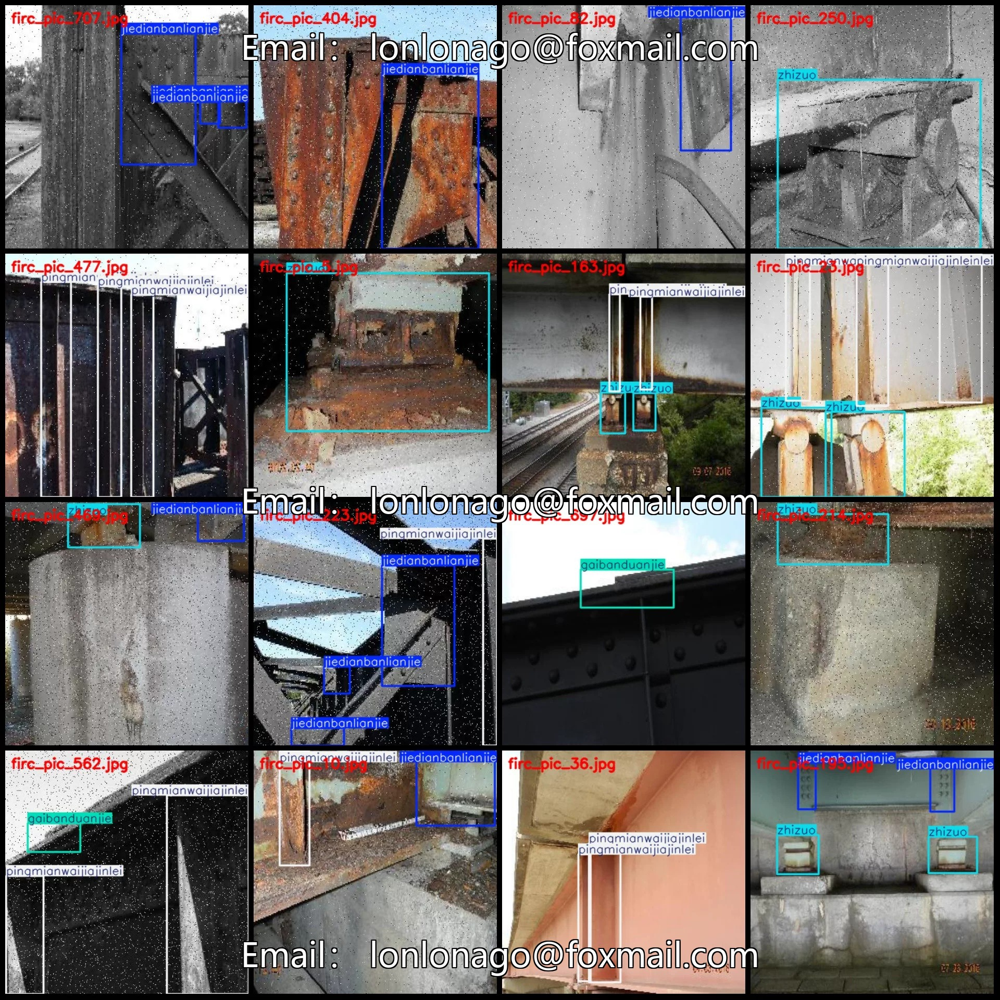
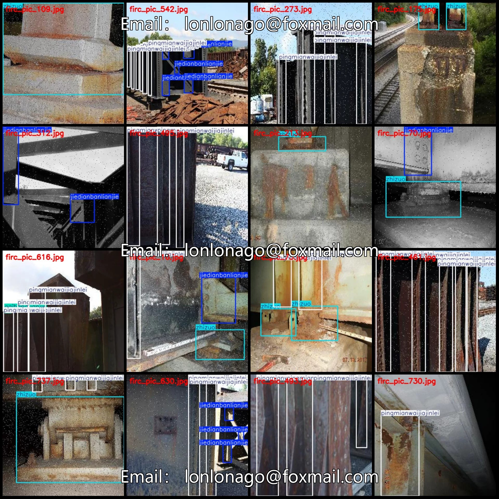
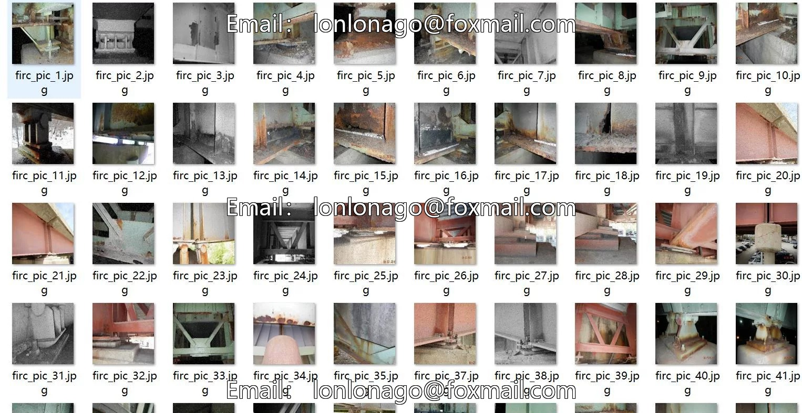
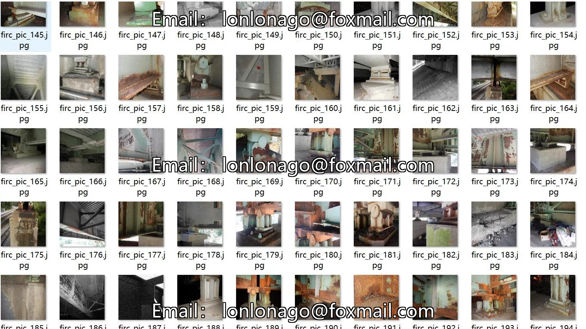
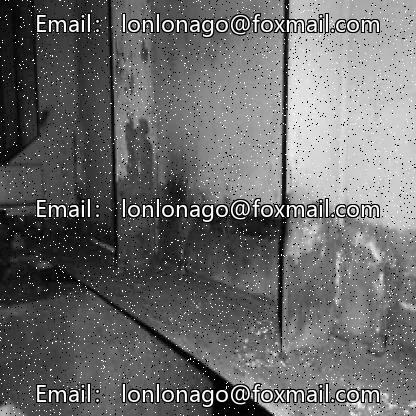
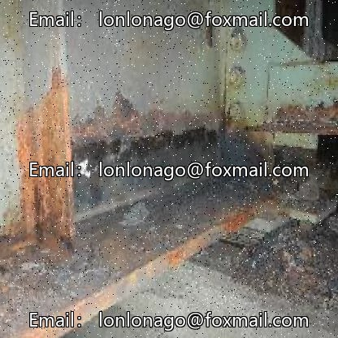
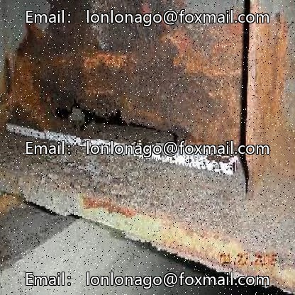

# Bridge steel structure detection dataset VOC+YOLO format, 750 images in 4 categories

## Body

Bridge Steel Structure Detection Dataset - VOC+YOLO format: 750 images in 4 categories
Warm Reminder: Due to the dataset's replicability, please confirm compliance with requirements before purchasing.
Dataset format: Pascal VOC format + YOLO format (txt files without split paths, only containing jpg images along with corresponding VOC format xml files and yolo format txt files)
Number of images (number of jpg files): 750
Number of annotations (number of xml files): 750
Number of annotations (number of txt files): 750
Number of annotation categories: 4

Label Category Names: ["gaibanduanjie", "jiedianbanlianjie", "pingmianwaijiajinlei", "zhizuo"]

Each category labeled with boxes and images count:
- "gaibanduanjie" has 185 boxes and 173 images.
- "jiedianbanlianjie" has 561 boxes and 244 images.

Pingmianwaijiajinlei Frames = 1067, Pictures = 361
Zhizuo Frames = 465, Pictures = 266
Total Frames: 2278
Image Resolution: 416x416
Labeling Tool: labelImg
Labeling Rules: Draw a rectangle around the category.
Important Notice: The dataset does not have separate training, validation, and test sets; you need to partition them yourself.
Special Remark: This dataset does not guarantee the accuracy of the trained models or weight files.

## Images

## Payment

Here is a pay link on Stripe ( https://buy.stripe.com/3cs8yP7sY87d0vu9AB ). Please contact me lonlonago@foxmail.com after funding $89, and I will send you a complete data files , thank you!

